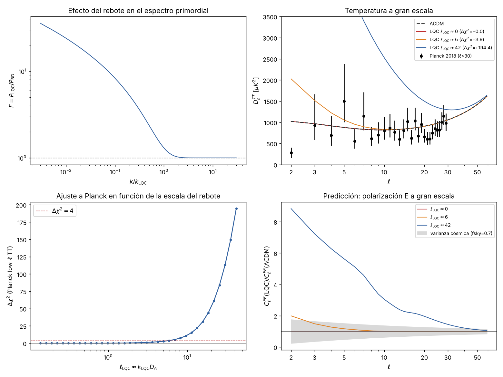

# Fase B: el rebote cuántico frente a los datos de Planck

> Primer contraste de la gravedad cuántica de bucles con datos reales en este
> proyecto. Cálculo propio, de principio a fin: espectro primordial con rebote
> → fondo cósmico de microondas → verosimilitud de Planck 2018.



## Resultado en una frase

Con el estado cuántico más simple (vacío adiabático antes del rebote), la
cosmología cuántica de bucles **aumenta** la potencia del fondo cósmico a gran
escala. Planck observa lo contrario (un déficit), así que los datos **no
favorecen** este modelo frente a ΛCDM y lo **acotan**: la escala del rebote
debe ser hoy mayor que la mitad del radio de Hubble, aproximadamente.

## Resultados

### 1. Efecto del rebote en el espectro primordial (figura, arriba izquierda)

| $k/k_{\rm LQC}$ | 0,003 | 0,01 | 0,1 | 0,5 | 1 | 2 | ≥ 3 |
|---|---|---|---|---|---|---|---|
| $\langle F\rangle = 1+2\lvert\beta_k\rvert^2$ | 35,7 | 24,0 | 8,29 | 2,34 | 1,30 | 1,02 | 1,000 |

- Por encima de $k_{\rm LQC}$ el rebote no deja huella: el espectro es el de
  la inflación estándar.
- Por debajo, el rebote **excita** los modos (crea pares de partículas) y la
  potencia aumenta, aproximadamente como $k^{-0.5}$ hacia el infrarrojo.
- **Validaciones:**
  - Conservación del wronskiano $|\alpha|^2-|\beta|^2 = 1$ con error $<10^{-4}$.
  - La evolución completa (400 modos por ventana, hasta la salida del
    horizonte), promediada, da 8,310 frente a 8,301 en $k = 0{,}1\,k_{\rm LQC}$
    y 1,305 frente a 1,302 en $k = k_{\rm LQC}$.
  - $\langle F\rangle$ no cambia (a 4 cifras para $k \ge 0{,}02\,k_{\rm LQC}$)
    al mover el instante del estado inicial entre $t_i = -10^3$ y $-10^5$, ni
    el de proyección entre $10^3$ y $10^4$.

### 2. Contraste con Planck (figura, abajo izquierda)

| $\ell_{\rm LQC} \approx k_{\rm LQC}D_A$ | ≤ 1 | 3 | 5 | **6,0** | 10 | 20 | 42 |
|---|---|---|---|---|---|---|---|
| $\Delta\chi^2$ (low-ℓ TT) | ≤ 0,1 | +1,2 | +2,9 | **+4** | +11 | +52 | +194 |

- **Ningún valor de $k_{\rm LQC}$ mejora el ajuste** respecto a ΛCDM: el mejor
  caso es el límite en que el rebote queda fuera del universo observable.
- **Cota (Δχ² = 4):**
  $$k_{\rm LQC}^{\rm fis} < 4{,}3\times10^{-4}\ \text{Mpc}^{-1} \approx 1{,}9\,a_0H_0 .$$
  En palabras: tuvo que haber suficiente inflación tras el rebote como para que
  su escala característica sea hoy, como mínimo, del orden del tamaño del
  universo observable. Si hubiera habido menos, Planck vería un cuadrupolo y
  un octupolo mucho mayores.

### 3. Predicción para la polarización (figura, abajo derecha)

En el borde de lo permitido ($\ell_{\rm LQC}\approx 6$) el modelo predice
$C_2^{EE}$ unas **2 veces** el valor de ΛCDM. Pero incluso un experimento
perfecto (limitado por la varianza cósmica, $f_{\rm sky}=0{,}7$, como
aproximadamente LiteBIRD) solo alcanzaría $\Delta\chi^2_{EE}\approx 2{,}7$:
la polarización **no puede decidir por sí sola** en la región que Planck aún
permite. Su papel sería combinarse con TT.

## Qué significa (y qué no)

- **No refuta la gravedad cuántica de bucles.** Refuta (o mejor: acota) una
  combinación concreta: LQC efectiva + métrica vestida + vacío adiabático en la
  contracción + inflación de Starobinsky.
- **El estado cuántico inicial es la pieza decisiva.** Se ha propuesto en la
  literatura que otros estados (Ashtekar–Gupt 2017; estados "no oscilantes" del
  enfoque híbrido de Martín de Blas y Olmedo 2016) **suprimen** la potencia en
  lugar de aumentarla, y Ashtekar, Gupt, Jeong y Sreenath (2020) sostienen que
  así se alivian las anomalías de Planck. Este cálculo muestra que con el
  estado más simple ocurre lo contrario, de modo que la conclusión depende de
  qué estado elija la naturaleza.
- **Es un resultado negativo útil:** indica que, si la LQC tiene que explicar
  las anomalías a gran escala, debe hacerlo con un estado inicial que suprima
  la potencia, y eso es lo que hay que calcular a continuación.

## Siguientes pasos

1. Implementar estados alternativos (Ashtekar–Gupt, no oscilante) y repetir el
   contraste. Si alguno mejora el ajuste, cuantificarlo con $\Delta\chi^2$ y
   comparar con el número de parámetros añadidos.
2. Liberar $A_s$, $n_s$ y $\tau$ y añadir la verosimilitud de alto ℓ y EE de
   bajo ℓ de Planck (marginalizar en lugar de fijar la cosmología).
3. Añadir modos tensoriales (ondas gravitacionales primordiales): predicción
   para los modos B.
4. Comparar el enfoque de métrica vestida con el híbrido para el mismo estado.

---

## 1. Método

### 1.1 Fondo (rebote + inflación)

Unidades de Planck. Dinámica efectiva de la cosmología cuántica de bucles con
un inflatón de Starobinsky:

$$
H^2 = \frac{8\pi}{3}\rho\Big(1-\frac{\rho}{\rho_c}\Big),\quad
\dot H = -4\pi\dot\phi^2\Big(1-\frac{2\rho}{\rho_c}\Big),\quad
\ddot\phi + 3H\dot\phi + V'(\phi) = 0,
$$

$$
V(\phi) = \frac{3M^2}{32\pi}\Big(1-e^{-\sqrt{16\pi/3}\,\phi}\Big)^2,\qquad M = 2.56\times10^{-6}.
$$

- $\rho_c = 0.4092$, $\gamma = 0.2375$. Rebote en $t=0$ con $a_B = 1$.
- $\phi_B = 3.54$, $\dot\phi_B<0$: rebote dominado por energía cinética,
  inflación a partir de $t \approx 3\times10^5$ y unos 70 e-folds.
- Escala del rebote: $k_{\rm LQC} = \sqrt{8\pi\rho_c} = 3.207$
  (raíz de $a''/a$ en el rebote).
- Detalle numérico: integrar $\dot H$ acumula un error que se comporta como
  curvatura espacial y crece como $a^4$ respecto a la energía cinética. Se
  corrige proyectando $|H|$ sobre la ligadura de Friedmann efectiva cuando
  $\rho < \rho_c/2$.

### 1.2 Perturbaciones

Enfoque de *métrica vestida* (Agullo, Ashtekar, Nelson):

$$
\ddot Q_k + 3H\dot Q_k + \Big(\frac{k^2}{a^2} + \mathfrak U\Big)Q_k = 0,\qquad
\mathfrak U = V_{\phi\phi} + fV + 2s\sqrt f\,V_\phi,\quad f = \frac{24\pi\dot\phi^2}{\rho}.
$$

En relatividad general $\mathfrak U$ coincide exactamente con el potencial de
Mukhanov–Sasaki (comprobado analíticamente); escrito con $\rho$ en lugar de
$H^2$ es finito en el rebote. $\mathcal R = HQ/\dot\phi$ y
$P_{\mathcal R} = k^3|\mathcal R|^2/2\pi^2$, evaluado cuando
$k/aH < 10^{-3}$.

- **Estado inicial:** vacío adiabático en la fase de contracción, en
  $t_i = -10^4$ (energía cinética dominante, $V/\rho \sim 10^{-3}$).
- **Referencia:** el mismo modo con vacío de Bunch–Davies al inicio de la
  inflación. $F(k) = P_{\rm LQC}/P_{\rm BD}$ aísla el efecto del rebote.
- **Convergencia:** RK4 con 200 pasos por oscilación; con 100 pasos el
  ultravioleta se desvía un 0,5 % por disipación numérica acumulada en
  $\sim10^5$ oscilaciones, con 200 la desviación es $<0{,}02\,\%$.

### 1.3 Fondo cósmico de microondas

$$
P(k) = A_s\Big(\frac{k}{k_p}\Big)^{n_s-1} F\Big(\frac{k}{k_{\rm LQC}^{\rm fis}}\Big).
$$

- Cosmología fija al mejor ajuste de Planck 2018 ($H_0 = 67.36$,
  $\Omega_bh^2 = 0.02237$, $\Omega_ch^2 = 0.1200$, $\tau = 0.0544$,
  $A_s = 2.1\times10^{-9}$, $n_s = 0.9649$).
- $k_{\rm LQC}^{\rm fis}$ (en Mpc⁻¹) es el único parámetro nuevo: la escala
  del rebote vista hoy. Depende de cuántos e-folds hubo entre el rebote y hoy,
  algo que la teoría por sí sola no fija.
- CAMB 2.0.5 calcula $C_\ell^{TT}$, $C_\ell^{EE}$.
- **Verosimilitud:** Planck 2018 TT de bajo ℓ (ℓ = 2–29, método de Gibbs
  "gaussianizado"), reimplementada a partir de la versión distribuida con
  cobaya. **Validación:** para ΛCDM da $-2\ln L = 23{,}46$, el valor que
  publica Planck.

### 1.4 Reproducir

```bash
pip install -r requirements.txt
python3 simulaciones/lqc_perturbaciones.py            # ~minutos, 4 núcleos
python3 simulaciones/cmb_lqc.py                        # descarga los datos de Planck la 1.ª vez
```
